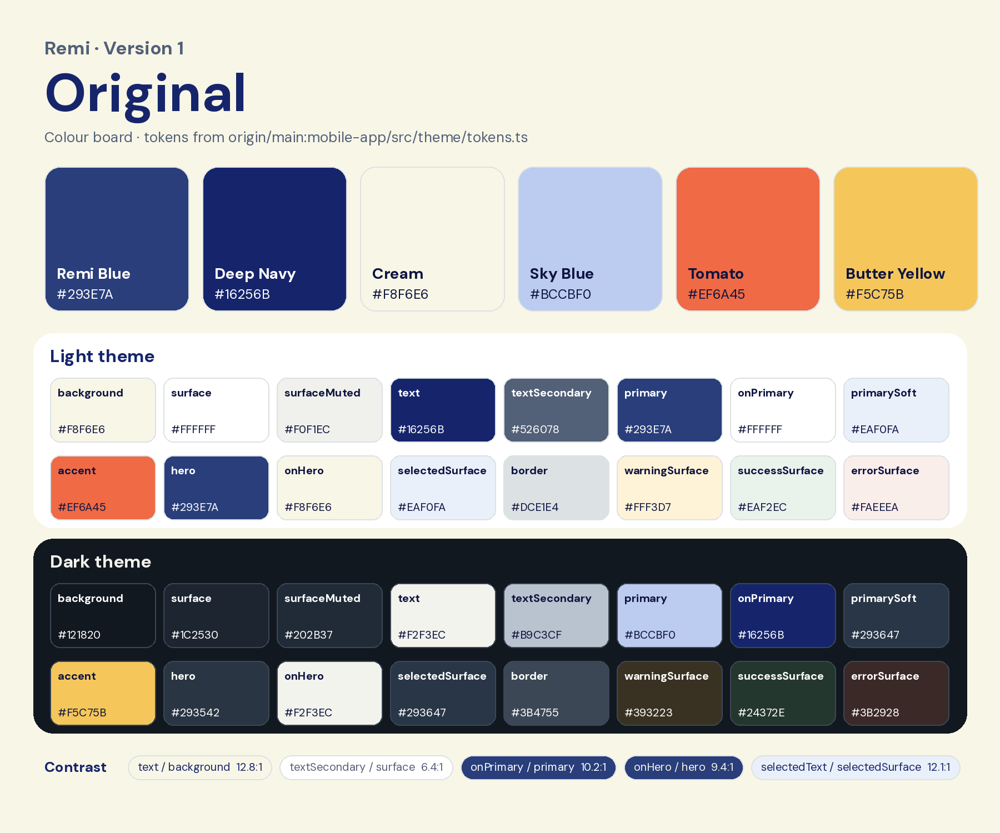

# Version 1: Original

The first native UI (`main`, Remy 0.2.0 design system): calm navy and cream, with tomato and butter as accents.

## Palette

| Name | Hex | Role |
|---|---|---|
| Remi Blue | `#293E7A` | Primary actions, hero |
| Deep Navy | `#16256B` | Text, pressed states |
| Cream | `#F8F6E6` | Background |
| Sky Blue | `#BCCBF0` | Primary colour in dark mode, muted hero text |
| Tomato | `#EF6A45` | Accent |
| Butter Yellow | `#F5C75B` | Accent in dark mode |

The full light and dark tokens are in [palette.json](palette.json).

## Type and assets

- **Type:** native system fonts (San Francisco on iOS, Roboto on Android). No brand fonts were bundled.
- **Icons:** `expo-symbols` system icons.
- **App icon and splash:** still the Expo template placeholders, so they are not archived here.
- **Design notes:** [design-system.md](design-system.md), the version 1 design-system write-up copied from `mobile-app/DESIGN-SYSTEM.md` on `main`.
- **Screenshots:** none were captured for version 1.
