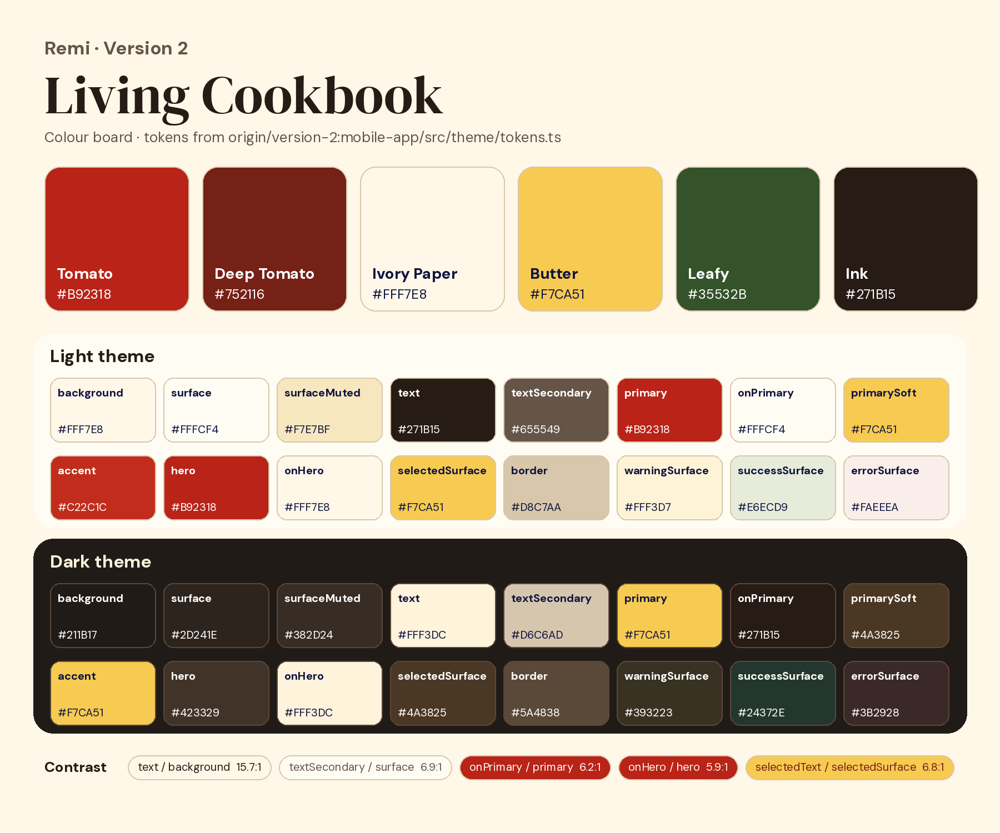

# Version 2: Living Cookbook

Warm paper, tomato red, butter yellow and leafy green, with an editorial serif and food photography (`version-2`).
The direction is described in [DESIGN.md](DESIGN.md) (copied from the branch).

## Palette

| Name | Hex | Role |
|---|---|---|
| Tomato | `#B92318` | Primary actions, hero |
| Deep Tomato | `#752116` | Pressed states |
| Ivory Paper | `#FFF7E8` | Background |
| Butter | `#F7CA51` | Selected states, "Use first" card. Primary colour in dark mode |
| Leafy | `#35532B` | Supporting cards, success |
| Ink | `#271B15` | Text |

The full light and dark tokens are in [palette.json](palette.json).

## Assets

| Folder | Contents |
|---|---|
| `fonts/` | DM Serif Display (titles) and DM Sans (body), with their OFL licences |
| `textures/` | `cookbook-paper.png`, the fine paper grain behind every screen (12% opacity) |
| `photography/` | 8 recipe photos and 4 ingredient cut-outs, plus the image manifests (origin and checksum of each file) |
| `screenshots/` | iOS Simulator captures of version 2 with the planning and onboarding work from #24 (onboarding, Home, Plan) |
