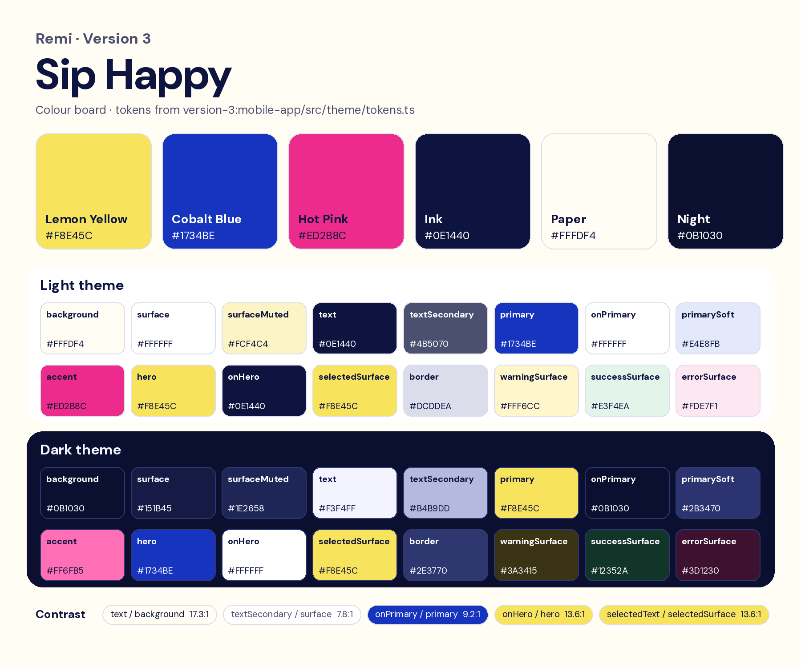

# Version 3: Sip Happy

Lemon base, cobalt action, hot-pink pop. It uses bold DM Sans, white rounded cards and pill controls, and takes its
patterns from the Mob meal-planner app (patterns only, no Mob assets). It adds the Remi chef mascot and wordmark
(`version-3`). The full log is in [VERSION-3.md](../../VERSION-3.md) and the rules are in [DESIGN.md](../../DESIGN.md).

## Palette

| Name | Hex | Role |
|---|---|---|
| Lemon Yellow | `#F8E45C` | **Base.** Hero, selected chips, active tab. Primary colour in dark mode |
| Cobalt Blue | `#1734BE` | **Action.** Buttons, links, focus, logo. Hero in dark mode |
| Hot Pink | `#ED2B8C` | **Pop, used sparingly.** Quick-add button, cook-mode progress. Text uses `#C2146C` |
| Ink | `#0E1440` | Text |
| Paper | `#FFFDF4` | Background |
| Night | `#0B1030` | Dark-mode background |

The full light and dark tokens are in [palette.json](palette.json). Every text pair meets WCAG AA; the ratios are on the board.
The three-colour idea came from a TikTok web-design tip by Marco Pérez.

## Assets

| Folder | Contents |
|---|---|
| `logo/` | `remi-logo-source.webp` (the original artwork) plus three white-on-transparent cuts the app recolours: `logo.png` (mascot and wordmark), `wordmark.png` and `mascot.png`. Regenerate them with `mobile-app/scripts/make-brand-assets.py` |
| `app-icon/` | The app icon: flat 1024 px, the iOS Icon Composer layer, the Android adaptive foreground and a preview at real sizes |
| `splash/` | Launch-screen logos: `splash-icon.png` (cobalt, on `#FFFDF4`) and `splash-icon-dark.png` (white, on `#0B1030`), shown 180 pt wide, plus simulator captures `launch-light.png` and `launch-dark.png` |
| `fonts/` | Static DM Sans cuts generated from the variable font: `DMSans-Display.ttf` (800, titles), `DMSans-Heading.ttf` (700), `DMSans-SemiBold.ttf` (600, labels), plus `DMSans.ttf` (body) and the OFL licence |
| `food-photography/` | The photo set behind every recipe and 474 ingredients: index, style guide, credits and a review sheet. See its README |
| `screenshots/` | iOS Simulator captures in light, dark and Arabic: Home, recipe, cook mode, shopping, planner, onboarding and the cook-mode done card |

**Logo usage:** cobalt on light surfaces, white on dark or cobalt surfaces. Use at most one mascot per screen.
The wordmark is cut from the composite art, so the tops of "e" and "m" are slightly flat where the mascot overlapped
them. A separate wordmark file from the designer would fix this.
