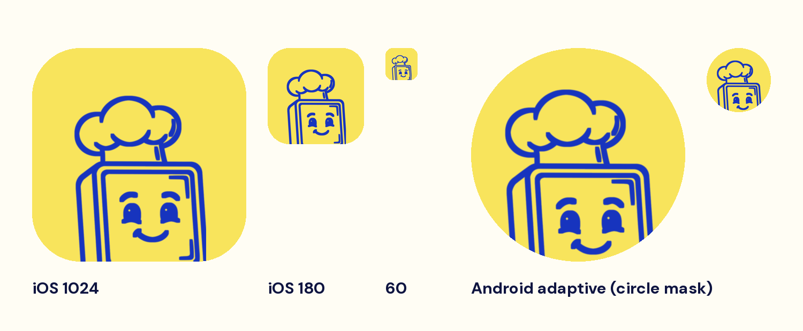
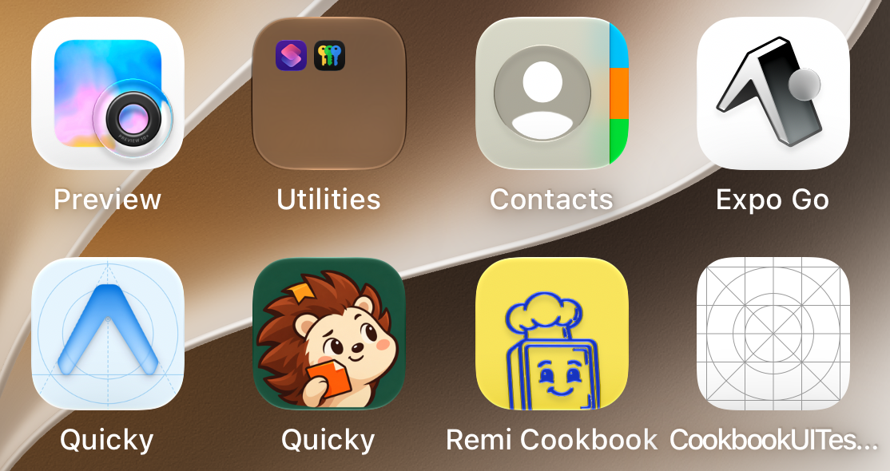

# App icon (version 3)

The chef's hat and face from the Remi logo, cobalt `#1734BE` on lemon `#F8E45C`, rising from the bottom edge.
The spoon, steam and arms are left out, and the strokes are thickened so the face still reads at 60 px.

On the iOS 27 Simulator home screen (Liquid Glass):

| File | Use |
|---|---|
| `icon-1024.png` | Flat icon, the `expo.icon` fallback |
| `ios-layer-chef.png` | The single layer in the iOS Icon Composer bundle `mobile-app/assets/remi.icon` (solid lemon fill, Liquid Glass) |
| `android-foreground.png` | Android adaptive foreground. It is smaller because launchers show only the centre two-thirds; the background is solid lemon |

The icons are generated by `mobile-app/scripts/make-app-icons.py` from `assets/brand/source/remi-logo.webp`.
Versions 1 and 2 shipped with the Expo template icon.
