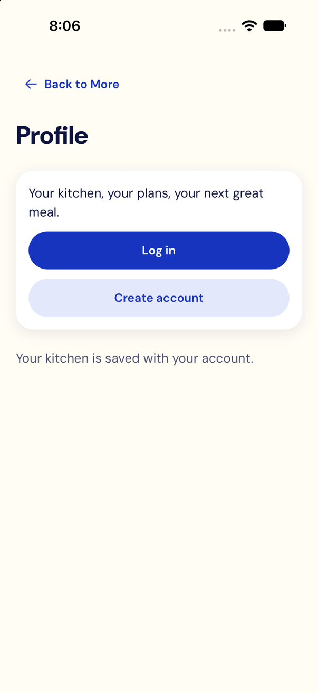
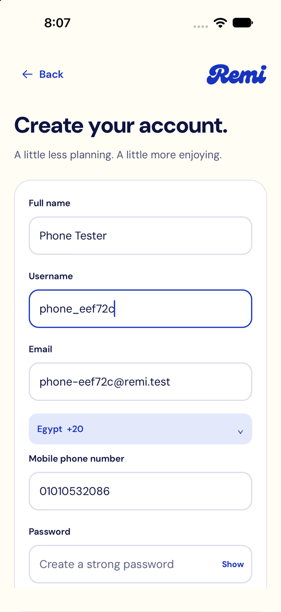
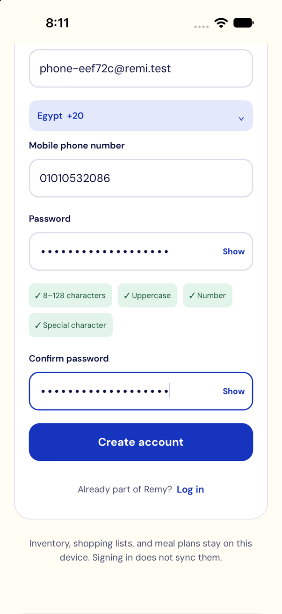
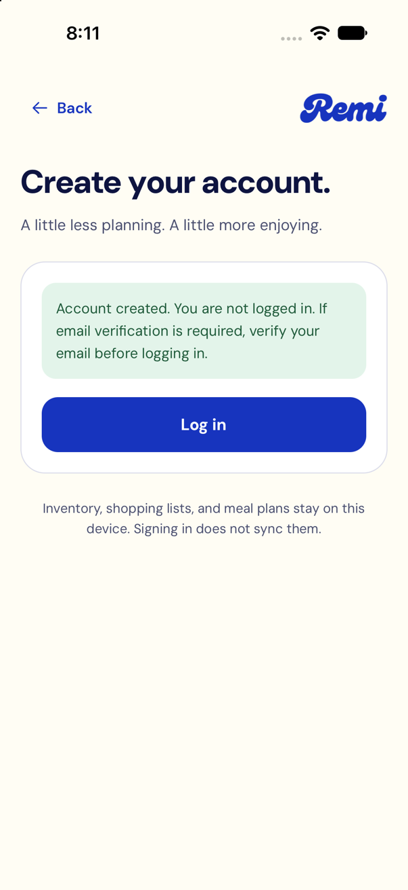
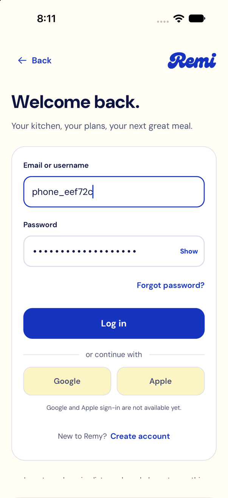
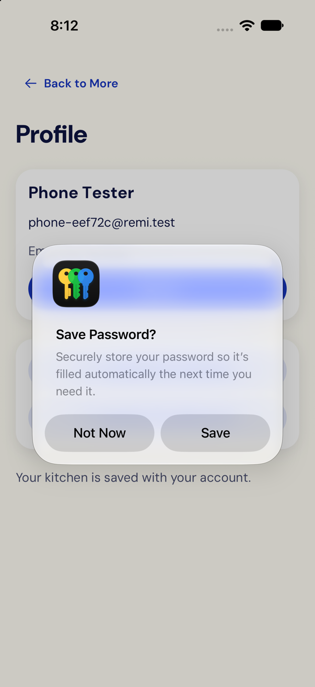

# Creating a Remi account on an iPhone

Walked through end to end on 8 November 2026: the account was created in the app, signed in by username, confirmed in
the database (with its household), and signed in again through the Mac's Wi-Fi address that the phone build uses.

How to create an account in the Remi app (version 3, local development server). The screenshots come from the iOS
Simulator, which runs the same app as a phone install.

## Before you start

- The phone and the Mac are on the same Wi-Fi network.
- On the Mac, Docker (the database) and the API are running, and the API answers on port 3000. The phone build has
  the Mac's Wi-Fi address built in (`EXPO_PUBLIC_API_URL`, for example `http://192.168.1.7:3000`). If that address
  changes, rebuild the app.
- This dev server has email verification turned off (`EMAIL_VERIFICATION_REQUIRED=false`), so no email is needed.
  Any verification mail would go to Mailpit on the Mac, not to a real inbox.

## Steps

### 1. Open Profile

Tap the round account button at the top right of Home, or go to **More → Your account**. When you're signed out,
Profile shows **Log in** and **Create account**. Tap **Create account**.

### 2. Fill in your details

| Field | Rule |
|---|---|
| Full name | Up to 100 characters, not blank |
| Username | 3–30 characters. Starts with a letter, then letters, digits or `_`. Stored in lower case, so it must be unique ignoring case |
| Email | A valid address, unique to this account |
| Country | **Egypt +20** or **Saudi Arabia +966** |
| Mobile phone number | Egypt: `010`, `011`, `012` or `015` followed by 8 digits (for example `010 1234 5678`). Saudi Arabia: `05` followed by 8 digits. Arabic digits are fine |
| Password | 8–128 characters, with at least one uppercase letter, one number and one special character. The four yellow checks tick as each rule is met |
| Confirm password | The same password again |

### 3. Create the account

Tap **Create account**.

- **First time on the phone:** iOS asks to let Remi find devices on your local network. Tap **Allow**, or the request
  can't reach the Mac. If you missed it, turn it on in Settings → Privacy & Security → Local Network → Remi.
- **On success** the form is replaced by: "Account created. You are not logged in." It **does not sign you in**.
- The server also creates a household called **My Kitchen**, with you as its owner.

### 4. Log in

Tap **Log in** under the message. Enter your **email or username** and your password, then tap **Log in**.

You land on Profile, which shows your name and email. "Email not verified" is expected on this dev server.

## Good to know

- **Your data on this phone:** the notice under the form explains that inventory, shopping lists and meal plans stay
  on the device. Signing in doesn't copy what you entered before signing in.
- **Too many attempts:** the server allows 10 sign-in or sign-up attempts per minute from one network address. After
  that you see "Too many requests"; wait a minute and try again.
- **Common errors:**
  - Username or email already in use: pick another.
  - Phone number rejected: it doesn't match the Egypt or Saudi format above.
  - Connection error: the Mac is asleep, the API isn't running, the phone is on a different network, or Local Network
    access is off.
- **Testing again from scratch:** Profile → **Log out**, then repeat from step 1 with a new username and email.
